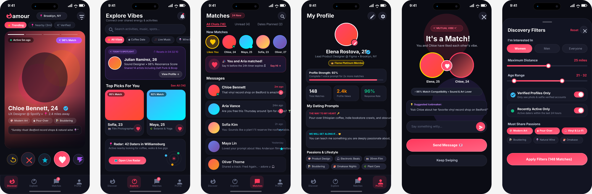
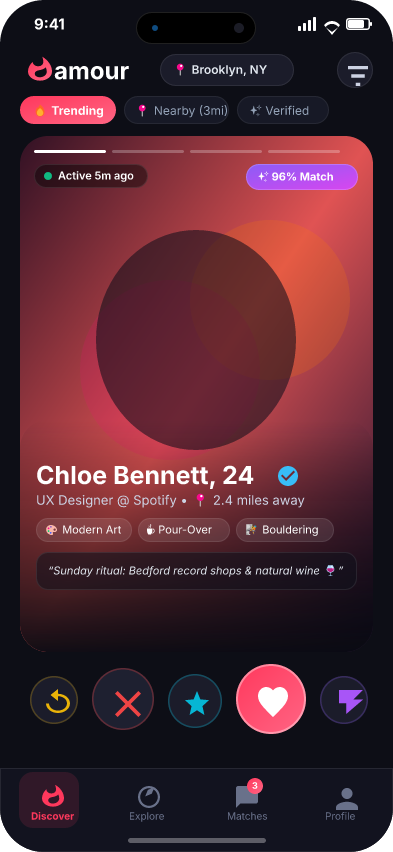
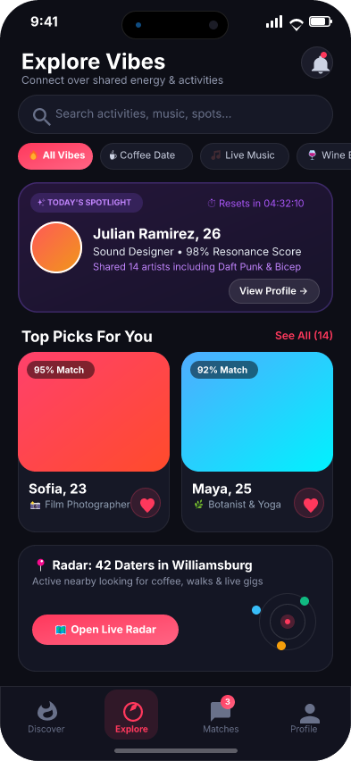
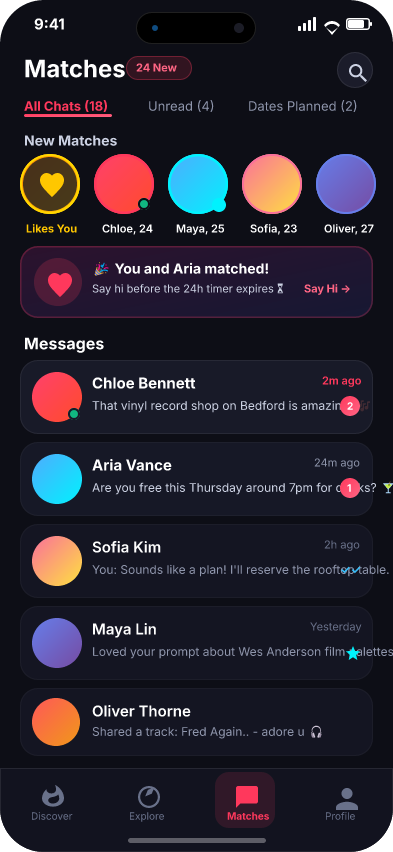
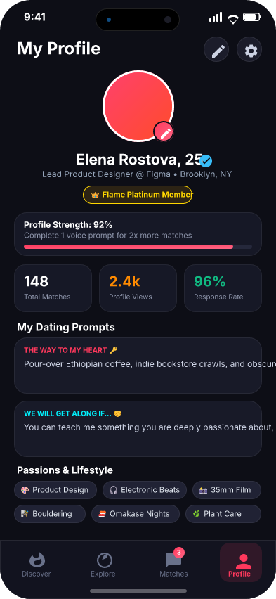

# Amour — Next-Gen Dating Mobile App & Agentic Design System

[](./skills)
[](./love.figcraft)
[](./LICENSE)

A complete, production-grade iOS dating application designed in native **FigCraft** vector format (`love.figcraft`), paired with an open-standard **Multi-Agent Skill Architecture** compatible with **Claude**, **Gemini / Antigravity**, **OpenAI Codex**, **Moonshot Kimi**, **Z.ai (GLM)**, and universal AI agent platforms.

---

## 📸 Visual Showcase

### Full Canvas Composite (6 Screens Side-by-Side)


### Screen Gallery

| 01 • Home (Discover) | 02 • Dashboard (Explore) | 03 • Match & Chats |
|:---:|:---:|:---:|
|  |  |  |
| **Swipe Discovery Card Stack**<br/>Chloe (24), verification badge, tags, quote card, and 5 action buttons. | **Activities & Vibe Feed**<br/>Search, vibe pills, Today's Spotlight, Top Picks grid, and Live Radar. | **Story Tray & Messages**<br/>Gold Likes counter, unread rings, match banner, and 5 conversation threads. |

| 04 • Profile & Stats | 05 • Match Celebration Modal | 06 • Discovery Filters Modal |
|:---:|:---:|:---:|
|  |  |  |
| **Profile & VIP Pass**<br/>Avatar with camera badge, VIP Platinum, 92% strength bar, metrics, and tags. | **"It's a Match!" Modal**<br/>Overlapping avatar halos, interlocking heart badge, and icebreaker input. | **Preferences Bottom Sheet**<br/>Interactive distance & age sliders, verification toggles, and passion chips. |

---

## 🎨 Design System & Specifications

All artboards use the native **iPhone 16** viewport standards (`393 × 852` pt):

- **Color Palette**:
  - `Background Dark`: `#0A0B10`
  - `Card Surface`: `#13151F`
  - `Card Border`: `#232738`
  - `Brand Primary / Coral Pink`: `#FF4B72`
  - `Brand Purple / Gradient Accent`: `#9B51E0`
  - `Gold / VIP Accent`: `#FFB800`
  - `Neon Teal / Online Status`: `#00F5D4`
  - `Text Primary`: `#FFFFFF`
  - `Text Secondary`: `#8E92A8`
- **Typography**: SF Pro Display & SF Pro Text.
- **Node Hierarchy**: 435 vector nodes organized into auto-layout stacks, card containers, interactive buttons, and modal overlays.
- **Interactive Prototyping**: Native `proto.interaction` links connecting bottom navigation tabs, Like button to Match Celebration, Filter icon to Preferences sheet, and dismiss buttons.

---

## 🤖 Multi-Agent Skills Architecture

This repository includes a multi-platform skill tree ready for direct consumption by any leading agentic runtime:

| Agent / Harness | Skill Path | Root Config | Description |
|---|---|---|---|
| **Universal / Standard** | `skills/` & `.agents/skills/` | [`AGENTS.md`](./AGENTS.md) | Universal skill specification compliant with open agent standards |
| **Anthropic Claude** | `.claude/skills/` | [`CLAUDE.md`](./CLAUDE.md) | Claude Code and Claude Desktop compatible skill folders |
| **Google Gemini & Antigravity** | `.gemini/skills/` | [`GEMINI.md`](./GEMINI.md) | Antigravity IDE and Gemini CLI skill integrations |
| **OpenAI Codex** | `.codex/skills/` | [`CODEX.md`](./CODEX.md) | Codex workspace automation and instruction prompts |
| **Moonshot Kimi** | `.kimi/skills/` | [`KIMI.md`](./KIMI.md) | Kimi K2.6 Turbo and FirePass agent configurations |
| **Z.ai GLM Developer Agent** | `.zda/skills/` | [`ZDA.md`](./ZDA.md) | Z.ai / GLM-4 tool integration and workspace guide |

### Skills Included

1. **`figcraft`** ([`skills/figcraft/SKILL.md`](./skills/figcraft/SKILL.md)):
   - Complete automation for the FigCraft desktop vector application and `figcraft-cli`.
   - Supports headless rendering, frame export, layer queries, JSON conversions, and live MCP control.
2. **`dating-app-design`** ([`skills/dating-app-design/SKILL.md`](./skills/dating-app-design/SKILL.md)):
   - Comprehensive mobile design guidelines for dating and social discovery applications.
   - Covers swipe card physics, match queues, discovery filters, trust badges, and dark obsidian color tokens.
3. **`deep-research-synthesizer`** ([`skills/deep-research-synthesizer/SKILL.md`](./skills/deep-research-synthesizer/SKILL.md)):
   - Advanced multi-perspective research investigation and evidence scoring skill.
   - Includes evaluation scripts (`scripts/score_evidence.py`, `scripts/matrix_generator.py`) and decision dossier templates (`templates/dossier_template.md`).

---

## 🚀 Working with FigCraft CLI

The vector design is stored in `love.figcraft`. You can inspect, render, and export it using the `figcraft-cli` binary:

```powershell
# Windows PowerShell
$FIGCRAFT = "D:\applications\FigCraft\FigCraft\figcraft-cli.exe"

# 1. Inspect artboards and node statistics
& $FIGCRAFT info love.figcraft

# 2. Render all screens into a single high-resolution canvas
& $FIGCRAFT render --out love_preview.png love.figcraft

# 3. Export all screens as individual PNG images to exports/
& $FIGCRAFT export --out exports/ love.figcraft

# 4. Convert FigCraft archive to human-readable JSON
& $FIGCRAFT convert love.figcraft love.json
```

### Running as an MCP Server

Connect FigCraft to Claude, Gemini, or Antigravity via the Model Context Protocol:

```bash
figcraft-cli mcp
```

Or connect directly to an open desktop FigCraft session on port 7979:

```bash
figcraft-cli mcp --attach 7979
```

---

## 📦 How to Upload to GitHub

Follow these steps to initialize and push this entire repository to your GitHub account:

```powershell
# 1. Initialize git repository
git init

# 2. Add all files (respects .gitignore)
git add .

# 3. Commit the repository
git commit -m "Initial commit: Amour dating app design with multi-agent skills for Claude, Gemini, Codex, ZDA, and Kimi"

# 4. Set main branch
git branch -M main

# 5. Add your GitHub remote repository URL
# Replace USERNAME and REPO with your GitHub repository details
git remote add origin https://github.com/USERNAME/REPO.git

# 6. Push to GitHub
git push -u origin main
```

---

## 📂 Repository Structure

```
love/
├── love.figcraft                     # Native FigCraft vector document (6 frames, 435 nodes)
├── love_preview.png                  # Canvas render showing all 6 screens side-by-side
├── exports/                          # Individual exported screen artboards
│   ├── Home.png
│   ├── Dashboard.png
│   ├── Match.png
│   ├── Profile.png
│   ├── Match Celebration.png
│   └── Discovery Filters.png
├── skills/                           # Standard skill definitions
│   ├── figcraft/
│   │   └── SKILL.md
│   ├── dating-app-design/
│   │   └── SKILL.md
│   └── deep-research-synthesizer/
│       ├── SKILL.md
│       ├── scripts/
│       │   ├── matrix_generator.py
│       │   └── score_evidence.py
│       └── templates/
│           └── dossier_template.md
├── .claude/skills/                   # Claude Code & Desktop skills mirror
├── .gemini/skills/                   # Google Gemini & Antigravity skills mirror
├── .codex/skills/                    # OpenAI Codex skills mirror
├── .kimi/skills/                     # Moonshot Kimi skills mirror
├── .zda/skills/                      # Z.ai / GLM skills mirror
├── .agents/skills/                   # Universal agent harnesses skills mirror
├── AGENTS.md                         # Universal agent workspace guide
├── CLAUDE.md                         # Anthropic Claude agent guide
├── GEMINI.md                         # Google Gemini / Antigravity agent guide
├── CODEX.md                          # OpenAI Codex / Copilot agent guide
├── KIMI.md                           # Moonshot Kimi agent guide
├── ZDA.md                            # Z.ai Developer Agent guide
├── .gitignore                        # Git ignore rules for clean repository
└── README.md                         # Complete project documentation & guide
```

---

## 📄 License

This project is licensed under the MIT License — see the [LICENSE](./LICENSE) file for details.
