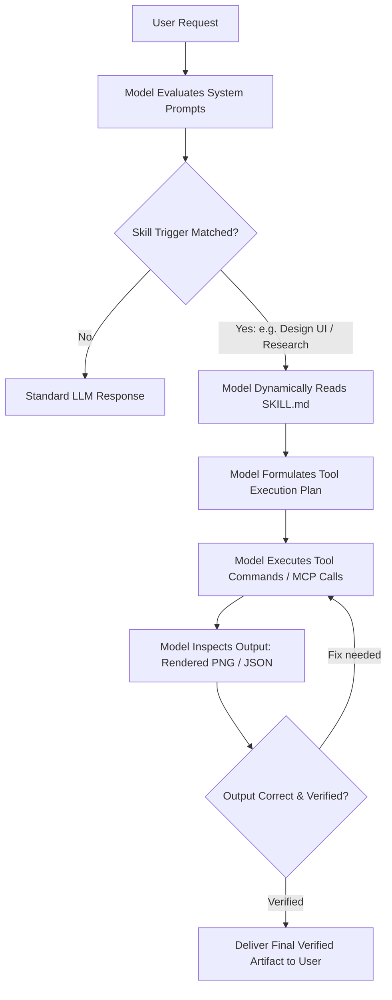

# Claude & AI Agent Tool Skills

[](https://skills.sh)
[](https://github.com/karthi11040/claude-skills)
[](https://github.com/vercel-labs/skills)
[](./LICENSE)

A collection of production-grade **AI Agent Tool Skills** that teach Large Language Models (**Claude Code**, **Gemini CLI**, **OpenAI Codex**, **Cursor**, **GitHub Copilot**, **Windsurf**, and universal coding agents) how to control external software tools, generate vector UI/UX architectures, and conduct verified deep research.

---

## ⚡ Quick Install

### 1. Claude Code (Plugin Marketplace)

Add this repository directly to Claude Code's marketplace and install the tool skills:

```bash
# Register this repository as a marketplace
/plugin marketplace add karthi11040/claude-skills

# Install the all-in-one engineering skills bundle:
/plugin install engineering-skills@claude-code-skills

# Or install individual tool skills:
/plugin install figcraft@claude-code-skills
/plugin install dating-app-design@claude-code-skills
/plugin install deep-research-synthesizer@claude-code-skills
```

---

### 2. Codex, Cursor, Gemini CLI, Copilot & Other Agents

Install directly via the open-source [skills](https://github.com/vercel-labs/skills) installer:

```bash
# Interactively discover and install skills from this repository:
npx skills add karthi11040/claude-skills

# Install a specific tool skill:
npx skills add karthi11040/claude-skills --skill figcraft
npx skills add karthi11040/claude-skills --skill dating-app-design
npx skills add karthi11040/claude-skills --skill deep-research-synthesizer

# Install globally for all supported coding agents (-g --all):
npx skills add karthi11040/claude-skills -g --all

# Target a specific agent:
npx skills add karthi11040/claude-skills --agent claude-code
npx skills add karthi11040/claude-skills --agent cursor
npx skills add karthi11040/claude-skills --agent codex
npx skills add karthi11040/claude-skills --agent gemini
```

---

### 3. One-Command Python Universal Installer

```bash
# Clone the repository
git clone https://github.com/karthi11040/claude-skills.git
cd claude-skills

# Automatically install all skills into all detected agent directories
python install.py
```

#### Direct ZIP Download:
- 📦 **Download Repository Archive**: [claude-skills.zip](https://github.com/karthi11040/claude-skills/archive/refs/heads/main.zip)

---

## 🧠 How Models Use These Tool Skills

Unlike static prompts, **Agent Skills** use **Progressive Disclosure** and **Active Tool Execution** to give AI models actionable capabilities without bloating their context window.



### 1. Discovery & Progressive Disclosure
1. When an agent boots, it indexes only the lightweight YAML frontmatter (`name` and `description`) of each skill.
2. The full contents of `SKILL.md`, supporting helper scripts, and templates remain on disk and are **only read into context when the user's intent matches the trigger condition**.

### 2. Autonomous Tool Invocation
When invoked, the skill instructs the model to execute specific CLI binaries, Model Context Protocol (MCP) servers, or Python helper scripts in the local workspace.

### 3. Closed-Loop Verification
The model does not simply assume its code worked. The skill enforces **evidence before assertions**:
- Running `figcraft-cli render` to visually inspect the resulting image.
- Running `scripts/verify_dossier.py` to calculate evidence confidence scores.
- Inspecting error codes and auto-correcting schema mistakes before replying to the user.

---

## 🛠️ Tool Skills Catalog

### 1. `figcraft` — Headless Vector UI/UX Tool Skill
**Location**: [`skills/figcraft/SKILL.md`](./skills/figcraft/SKILL.md)  
**Trigger**: When the user asks to inspect, design, modify, prototype, render, or export `.figcraft` vector design files.

#### How the Model Uses This Tool:
The model interacts with the local `figcraft-cli` binary or the FigCraft MCP server to perform surgical vector operations:

```
User: "Add a dark mode Profile screen with user stats to app.figcraft"
  │
  ├── 1. Inspect: & "figcraft-cli.exe" info app.figcraft
  │      Model discovers existing artboard bounds, frame IDs, and layout positions.
  │
  ├── 2. Execute: & "figcraft-cli.exe" run create_profile.json --in app.figcraft --out app.figcraft
  │      Model emits procedural batch commands to create rectangles, text nodes, avatar halos, and buttons.
  │
  ├── 3. Link Interactions: & "figcraft-cli.exe" run link_nav.json --in app.figcraft --out app.figcraft
  │      Model wires prototype transitions (proto.interaction.add) between tabs and screens.
  │
  ├── 4. Render & Verify: & "figcraft-cli.exe" render --out app_preview.png app.figcraft
  │      Model views the resulting preview image to confirm alignments, spacing, and visual contrast.
  │
  └── 5. Export: & "figcraft-cli.exe" export --out exports/ app.figcraft
         Model extracts individual PNG artboards for production handoff.
```

#### MCP Integration:
The model can also drive a live desktop FigCraft canvas in real time:
```bash
figcraft-cli mcp --attach 7979
```

---

### 2. `dating-app-design` — Mobile UX Architecture Skill
**Location**: [`skills/dating-app-design/SKILL.md`](./skills/dating-app-design/SKILL.md)  
**Trigger**: When the user asks to design, evaluate, or code mobile discovery, matchmaking, or social connection applications.

#### How the Model Uses This Tool:
The model applies strict, high-conversion design patterns and token hierarchies:
- **Design Tokens**: Deep obsidian `#0D0E16`, elevated card surfaces `#161826`, vibrant coral `#FF385C`, electric violet `#8B5CF6`, sunset gold `#FF8A00`.
- **Card Physics & Scrim**: Enforces full-bleed photo cards with bottom gradient scrims (`#00000000` to `#080911F5`) to guarantee AAA contrast for typography.
- **Action Hierarchy**: Standardizes ergonomic floating action buttons (Rewind, Pass, Super Like, Match, Boost).
- **Prototyping Links**: Automatically connects swipe actions to match celebration modals and filter buttons to bottom sheets.

---

### 3. `deep-research-synthesizer` — Multi-Perspective Investigation Skill
**Location**: [`skills/deep-research-synthesizer/SKILL.md`](./skills/deep-research-synthesizer/SKILL.md)  
**Trigger**: When the user requests in-depth research, claims verification, competitor analysis, or structured decision dossiers.

#### How the Model Uses This Tool:
The model uses automated Python verification tools packaged directly inside the skill:
```
User: "Investigate whether we should adopt technology X over Y for our stack"
  │
  ├── 1. Intake & Scope: Model classifies audience (Everyday vs Technical) and defines key hypotheses.
  │
  ├── 2. Evidence Triangulation: Model gathers opposing viewpoints across literature and benchmarks.
  │
  ├── 3. Automated Scoring: python skills/deep-research-synthesizer/scripts/score_evidence.py
  │      Model runs algorithmic scoring on source credibility, empirical backing, and bias.
  │
  ├── 4. Matrix Generation: python skills/deep-research-synthesizer/scripts/matrix_generator.py
  │      Model generates trade-off comparison tables and confidence scorecards.
  │
  └── 5. Dossier Delivery: Model compiles the verified decision dossier using templates/dossier_template.md.
```

---

## 📱 Real-World Case Study: `love.figcraft`

To prove the power of these tool skills, this repository includes a complete production dating app design created entirely by an AI agent using the **`figcraft`** and **`dating-app-design`** skills:

- **Source File**: [`love.figcraft`](./love.figcraft) (Native FigCraft archive, 435 vector nodes across 6 top-level artboards).
- **Composite Render**: [`love_preview.png`](./love_preview.png) (Full canvas render of all 6 screens side-by-side).
- **Exported Artboards**: [`exports/`](./exports/) (`Home.png`, `Dashboard.png`, `Match.png`, `Profile.png`, `Match Celebration.png`, `Discovery Filters.png`).

### Visual Showcase (Generated by AI Model):


| 01 • Home (Discover) | 02 • Dashboard (Explore) | 03 • Match & Chats |
|:---:|:---:|:---:|
|  |  |  |

| 04 • Profile & Stats | 05 • Match Celebration | 06 • Discovery Filters |
|:---:|:---:|:---:|
|  |  |  |

---

## 🌐 Multi-Agent Platform Support

This repository is structured to work out-of-the-box across all leading AI coding assistants:

| Platform | Skills Path | Agent Guide | Supported Invocation |
|---|---|---|---|
| **Anthropic Claude Code** | `.claude/skills/` | [`CLAUDE.md`](./CLAUDE.md) | `/plugin marketplace add karthi11040/claude-skills`<br/>`/plugin install engineering-skills@claude-code-skills` |
| **OpenAI Codex & Copilot** | `.codex/skills/` | [`CODEX.md`](./CODEX.md) | `npx skills add karthi11040/claude-skills -a codex` |
| **Google Gemini & Antigravity** | `.gemini/skills/` | [`GEMINI.md`](./GEMINI.md) | `npx skills add karthi11040/claude-skills -a gemini` |
| **Cursor & Windsurf** | `.agents/skills/` | [`AGENTS.md`](./AGENTS.md) | `npx skills add karthi11040/claude-skills -a cursor` |
| **Moonshot Kimi** | `.kimi/skills/` | [`KIMI.md`](./KIMI.md) | `python install.py --platform kimi` |
| **Z.ai Developer Agent (GLM)** | `.zda/skills/` | [`ZDA.md`](./ZDA.md) | `python install.py --platform zda` |

---

## 📂 Repository Structure

```
claude-skills/
├── skills/                           # Canonical skill packages (for npx skills add)
│   ├── figcraft/
│   │   ├── SKILL.md                  # FigCraft CLI & MCP automation instructions
│   │   └── AGENTS.md
│   ├── dating-app-design/
│   │   ├── SKILL.md                  # Mobile UX architecture & design tokens
│   │   └── AGENTS.md
│   └── deep-research-synthesizer/
│       ├── SKILL.md                  # Investigation workflow & scoring instructions
│       ├── README.md
│       ├── install_skill.py
│       ├── scripts/
│       │   ├── matrix_generator.py   # Matrix comparison script
│       │   ├── score_evidence.py     # Source credibility scoring script
│       │   └── verify_dossier.py     # Dossier verification script
│       └── templates/
│           ├── executive-brief.md
│           └── technical-deep-dive.md
├── .claude-plugin/                   # Claude Code plugin marketplace manifests
│   ├── marketplace.json
│   └── plugin.json
├── plugins/                          # Claude Code plugin packages
│   ├── amour-skills/                 # All-in-one engineering-skills bundle
│   ├── dating-app-design/
│   ├── figcraft/
│   └── deep-research-synthesizer/
├── package.json                      # Node & skills registry manifest
├── install.py                        # Cross-platform Python installer
├── love.figcraft                     # Reference vector file generated using skills
├── love_preview.png                  # Canvas snapshot generated via figcraft-cli render
├── exports/                          # Artboard snapshots generated via figcraft-cli export
├── .claude/skills/                   # Claude mirror
├── .gemini/skills/                   # Gemini mirror
├── .codex/skills/                    # Codex mirror
├── .kimi/skills/                     # Kimi mirror
├── .zda/skills/                      # ZDA mirror
├── .agents/skills/                   # Universal agent mirror
├── AGENTS.md                         # Universal agent guide
├── CLAUDE.md                         # Claude Code guide
├── CODEX.md                          # OpenAI Codex guide
├── GEMINI.md                         # Google Gemini / Antigravity guide
├── KIMI.md                           # Moonshot Kimi guide
├── ZDA.md                            # Z.ai Developer Agent guide
├── .gitignore
└── LICENSE
```

---

## 📄 License

This repository is licensed under the MIT License — see the [LICENSE](./LICENSE) file for details.
